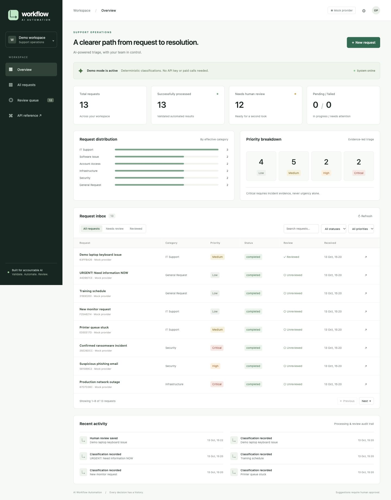
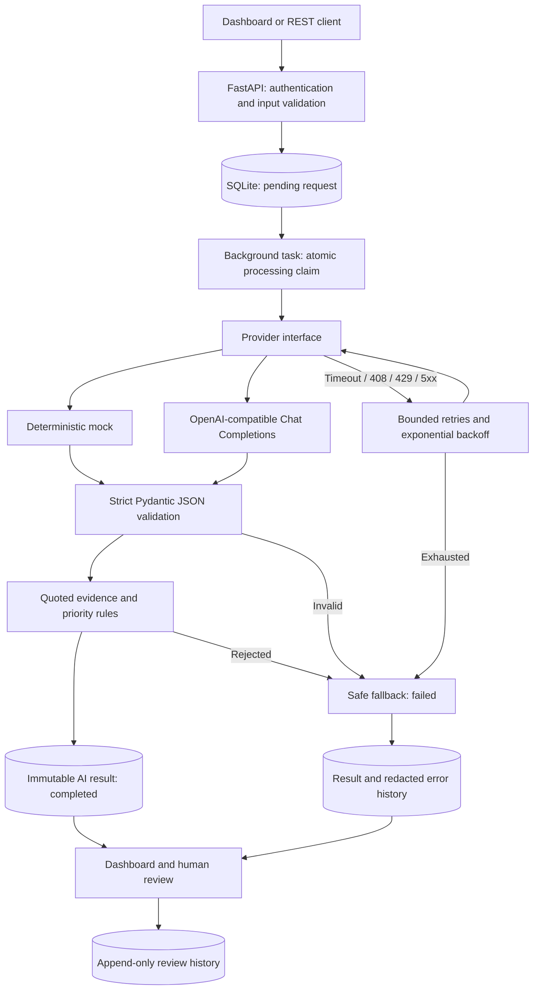

# AI Workflow Automation

An auditable support-triage application that turns incoming requests into validated, structured classifications, routes failures to manual review, and preserves the distinction between automated decisions and human corrections.

Built as an interview-ready engineering MVP with **FastAPI, Pydantic, SQLAlchemy, SQLite, and an OpenAI-compatible provider**. It runs locally without credentials using a clearly labeled deterministic mock provider.



## What works

- Submit and persist requests with UUIDs, timestamps, and explicit processing states.
- Extract category, priority, summary, suggested action, confidence, and quoted evidence.
- Request a strict JSON Schema from a live provider; independently validate every output with Pydantic and business rules.
- Retry transient errors with bounded exponential backoff; persist safe error codes and validation details.
- Track failures honestly: a fallback remains **failed**, never a successful AI result.
- Review categories and priorities, edit and approve suggested actions, and retain every original AI result and human review.
- Explore a responsive dashboard with metrics, filters, pagination, request details, and a recent activity feed.
- Run offline tests and a small synthetic evaluation without paid API access.

**Scope:** action approval is an audit record. This MVP does not execute suggested commands, send messages, or modify third-party systems.

## Architecture



| Layer | Responsibility |
| --- | --- |
| `app/main.py` | App factory, API routes, dependency injection, HTTP safeguards, serialization |
| `app/schemas.py` | Typed request/response models and strict AI output contract |
| `app/providers/` | Mock and live transport adapters; no database access |
| `app/rules.py` | Evidence grounding and conservative Critical-priority checks |
| `app/pipeline.py` | Validation, retry policy, safe fallbacks, atomic processing and recovery |
| `app/models.py`, `app/db.py` | SQLAlchemy relationships, SQLite transactions, foreign keys and WAL |
| `app/static/` | Same-origin HTML/CSS/JavaScript dashboard; no frontend build step |
| `scripts/`, `evaluation/` | Synthetic demo data and reproducible evaluation |

**Stack:** Python 3.11+, FastAPI, Pydantic v2, SQLAlchemy 2, SQLite, HTTPX, Uvicorn, vanilla JavaScript, Pytest, Ruff, Docker, and GitHub Actions.

## Quick start

From the repository root, using Python 3.11 or newer:

```bash
git clone https://github.com/batuhanozen/ai-workflow-automation.git
cd ai-workflow-automation
python3 -m venv .venv
source .venv/bin/activate
pip install -e '.[dev]'
cp .env.example .env
python -m scripts.seed_demo
uvicorn app.main:create_app --factory --host 127.0.0.1 --port 8000 --no-access-log
```

On Windows, activate with `.venv\Scripts\Activate.ps1` in PowerShell. Open [the dashboard](http://127.0.0.1:8000), [interactive API docs](http://127.0.0.1:8000/docs), or [health](http://127.0.0.1:8000/health).

Seeding is optional and safe to rerun: it skips existing titles, inserts only synthetic examples, and always uses the mock provider. The initial database is created automatically. Runtime data is ignored by Git.

Use **one Uvicorn worker and one app instance per database**. Startup recovery assumes the previous process has stopped. Do not run multiple app instances, reload workers, or seed concurrently against an actively processing database.

### Docker

```bash
cp .env.example .env
docker compose up --build
```

The application runs as a non-root user, exposes port 8000 on host loopback, and stores SQLite in a named volume. To populate a Docker demo, seed while the app is stopped:

```bash
docker compose stop app
docker compose run --rm --entrypoint python \
  -v "$PWD/scripts:/app/scripts:ro" \
  -v "$PWD/evaluation:/app/evaluation:ro" \
  app -m scripts.seed_demo
docker compose up -d
```

The image includes the runtime application only. Docker commands require Docker Engine/Desktop; a container build was not verified in the development environment because Docker was unavailable.

## Configuration and live AI

| Variable | Default | Purpose |
| --- | --- | --- |
| `AI_PROVIDER` | `mock` | `mock` or `openai` |
| `DATABASE_URL` | `sqlite:///./data/workflows.db` | SQLite location |
| `OPENAI_API_KEY` | empty | Required for the live provider |
| `OPENAI_BASE_URL` | `https://api.openai.com/v1` | Compatible API base URL |
| `OPENAI_MODEL` | `gpt-4o-mini` | Configurable model identifier supported by your provider |
| `LLM_TIMEOUT_SECONDS` | `15` | HTTPX network-operation timeout |
| `LLM_MAX_ATTEMPTS` | `3` | Total attempts, including the first; maximum 5 |
| `LLM_BACKOFF_SECONDS` | `0.5` | Initial retry delay; doubles per retry |
| `API_KEY` | empty | Optional development API key; protects every `/api/*` route |
| `APP_ENV` | `development` | `production` requires an API key of at least 32 characters |

For real LLM inference, edit your local `.env`:

```dotenv
AI_PROVIDER=openai
OPENAI_API_KEY=your-provider-key
OPENAI_BASE_URL=https://api.openai.com/v1
OPENAI_MODEL=gpt-4o-mini
```

Restart the server after changing configuration. Live mode sends request titles and descriptions to the configured provider and can incur charges. Use synthetic data for demonstrations. Never commit `.env` or paste credentials into tickets.

The adapter uses Chat Completions `response_format.type=json_schema` with `strict=true`, following the [official structured outputs documentation](https://developers.openai.com/api/docs/guides/structured-outputs?api-mode=chat). A compatible endpoint must support that contract. Refusals, truncated responses, unsupported schemas, and malformed envelopes fail visibly; there is no silent downgrade to unvalidated text. The live HTTP contract is tested with `httpx.MockTransport`; a paid live-model call has **not** been run.

Mock mode is a keyword classifier, not a local LLM. It exercises the same validation and persistence pipeline but cannot demonstrate semantic inference quality.

## Classification policy

| Category | Typical evidence |
| --- | --- |
| IT Support | Devices, printers, peripherals |
| Software Issue | Application defects, crashes, export errors |
| Account Access | Authentication, passwords, permissions |
| Infrastructure | Shared networks, servers, databases |
| Security | Suspected attacks, phishing, compromise |
| General Request | Informational or other routine service requests |

| Priority | Intended interpretation |
| --- | --- |
| Low | Informational, routine, or cosmetic issue |
| Medium | Limited degradation without a confirmed major impact |
| High | A blocked user or a suspected security issue |
| Critical | Explicit affirmative evidence of an active/confirmed security incident or widespread outage |

Every successful automated result must include a verbatim source excerpt, preserving its original casing. Critical also requires matching impact, confidence of at least 0.8, and an accepted affirmative incident/outage pattern. The validator checks surrounding source context to prevent cropping out a negation. Urgent language alone cannot satisfy the rule. A failed rule sends the ticket to a **failed/manual-triage** state rather than pretending a successful decision.

These checks are conservative heuristics, not independent verification that an incident occurred. They can miss paraphrases and complex negations; confidence is an uncalibrated model self-estimate. Human reviewers may override automated categories and priorities with a recorded explanation.

## API examples

If `API_KEY` is configured, add `-H "X-API-Key: $API_KEY"` to API calls. In the dashboard, use the gear button to enter it; the key stays in page memory and clears on reload. Health, static assets, and OpenAPI documentation are public; request data is protected by `/api/*` authentication.

```bash
curl -X POST http://127.0.0.1:8000/api/requests \
  -H 'Content-Type: application/json' \
  -d '{"title":"Password reset needed","description":"I forgot my demo account password and need a reset."}'
```

Returns `201` with a UUID and `status: pending`. Processing runs after the response. Poll the detail endpoint for completion:

```bash
curl http://127.0.0.1:8000/api/requests/REQUEST_UUID
curl 'http://127.0.0.1:8000/api/requests?status=failed&limit=20&offset=0'
curl 'http://127.0.0.1:8000/api/requests?needs_review=true&priority=High'
curl http://127.0.0.1:8000/api/stats
curl http://127.0.0.1:8000/api/activity
```

A review must include the **current `version` from the detail response**, preventing stale updates:

```bash
curl -X POST http://127.0.0.1:8000/api/requests/REQUEST_UUID/reviews \
  -H 'Content-Type: application/json' \
  -d '{"category":"Account Access","priority":"High","suggested_action":"Verify identity and restore access.","action_approved":true,"reviewer":"Demo reviewer","note":"Confirmed the user is blocked from work.","expected_version":3}'

curl -X POST http://127.0.0.1:8000/api/requests/REQUEST_UUID/retry
```

Retries return `202` and are permitted only for **failed, unreviewed** requests. In-flight, completed, reviewed, or stale updates return `409`; malformed input returns a redacted `422`. Listing supports title search (`q`), category, priority, status, review status, and bounded pagination. See `/docs` for complete request and response schemas.

## Persistence and failure semantics

- `requests`: immutable input, creation/update times, state, version, review flag, and materialized effective category/priority.
- `ai_results`: one immutable record per processing run, provider/model/prompt version, validated output or explicit fallback, attempt count, and duration.
- `processing_errors`: one record per failed attempt with timestamp, safe code, retryability, and field/type validation details. Raw provider bodies, exception messages, and credentials are excluded.
- `reviews`: append-only reviewer notes, category, priority, suggested action, approval, and a link to the exact AI result reviewed.

A request moves `pending → processing → completed | failed`. Retry moves an eligible failure back to pending; atomic database claims prevent duplicate processing. Reviewing a failure leaves its processing status **failed**. Human review and processing status are separate dimensions.

Transient transport errors, timeouts, HTTP 408/429, and 5xx responses retry after 0.5 and 1 second by default. Permanent HTTP errors, refusals, malformed JSON, invalid schemas, and business-rule failures do not retry. At exhaustion, a neutral General Request / Medium placeholder with zero confidence requires manual triage; it is not an urgency assessment. If the input cannot provide a usable excerpt, the fallback explicitly says that evidence is unavailable rather than failing validation itself.

Requests interrupted by process exit are marked failed on the next startup, with an interruption error and explicit fallback. History is never erased by retry. Disk/database failures can leave a processing row for recovery on restart; this is not a durable job queue.

Dashboard totals describe **current request states**, not total historical attempts. Category/priority charts include fallback values and human corrections; inspect failure and review states when interpreting them. Recent activity and individual details expose the underlying history.

## Tests and checks

```bash
pytest --cov=app --cov-report=term-missing
ruff check .
ruff format --check .
npx --yes prettier@3.6.2 --check 'app/static/*'  # Optional frontend formatting check.
node --check app/static/app.js  # Optional JS syntax check; Node is not needed to run the app.
```

Tests use temporary SQLite databases and mocked providers, including an intercepted live HTTP adapter. They cover creation, persistence, strict output validation, invalid JSON, evidence rules, timeout and HTTP failure handling, backoff/exhaustion, fallbacks, retries, restart recovery, concurrent processing claims, optimistic review conflicts, immutable AI history, authentication, and API validation. No paid API access is needed.

GitHub Actions is configured for Python 3.11, 3.12, and 3.13. Local verification and its limits are recorded in [docs/verification.md](docs/verification.md). The final engineering review, fixes, security checks, and GitHub publication status are in [docs/engineering-review.md](docs/engineering-review.md).

## Evaluation

```bash
python -m scripts.evaluate
python -m scripts.evaluate --output evaluation/mock-results.json
# Explicit opt-in to configured, potentially paid live calls:
python -m scripts.evaluate --live --output data/live-evaluation.json
```

All four metrics use **all dataset cases** as the denominator. Category and priority accuracy count failed cases as incorrect even when fallback labels happen to match. Schema success measures whether an AI output passed schema validation; a later business-rule rejection may still count as schema-valid. Processing success requires both schema and business-rule validation.

Checked-in [mock results](evaluation/mock-results.json) on 18 synthetic cases:

| Metric | Result |
| --- | ---: |
| Category accuracy | 88.89% (16/18) |
| Priority accuracy | 83.33% (15/18) |
| Schema validation success | 100% (18/18) |
| Processing success | 100% (18/18) |

The mock misses paraphrases such as “authentication token” and “data warehouse,” and over-prioritizes a resolved incident. The dataset is small, English-only, manually labeled, includes simple examples aligned with mock rules, and has no independent held-out split or statistical uncertainty estimate. It is an engineering smoke evaluation, **not evidence of production LLM accuracy**. See [evaluation/README.md](evaluation/README.md).

## Screenshots and interview walkthrough

Screenshots are captured from the working application with synthetic data:

- [Desktop dashboard](docs/screenshots/dashboard.jpg)
- [Human review](docs/screenshots/review.jpg)
- [Mobile layout](docs/screenshots/mobile.jpg)

Suggested five-minute demonstration:

1. Seed requests, start the app, and explain the mock provider banner.
2. Submit an “URGENT” information request; show that urgency alone does not produce Critical.
3. Open a confirmed outage and inspect its quoted evidence and immutable result.
4. Correct a priority, approve the suggestion, and compare review history to the original AI result.
5. Run the retry/fallback tests and evaluation; explain why schema validity is different from semantic correctness.

## Security and operational boundaries

Input length bounds, a 64 KiB streamed body limit, parameterized SQLAlchemy queries, constant-time API-key comparison, same-origin assets, output escaping, a dashboard CSP, redacted validation errors, environment-based secrets, and ignored databases provide basic safeguards. The container binds to host loopback by default. Logs are structured JSON events without ticket content or provider response bodies.

For an externally reachable deployment, add TLS, authenticated users, authorization, rate limits, and request-duration limits at a reverse proxy. A shared API key is not user identity: reviewer names are self-reported, and audit records are append-only through the application, not tamper-proof against database administrators. SQLite is not encrypted; backups and data retention are the operator's responsibility. Demo mode is intentionally unauthenticated unless configured otherwise.

## Known limitations and Phase 2

This MVP uses in-process background tasks, synchronous provider calls in worker threads, one SQLite database, and startup-created tables. It has no durable distributed queue, automatic schema migrations, multi-tenancy, or production identity system. The list endpoint loads the selected requests' result/review histories, which is suitable for a demo but needs optimization at scale. Provider-specific schema support and model availability vary. Suggested actions are never executed automatically.

Priorities for Phase 2:

1. Durable workers with leases, idempotency keys, bounded queue capacity, dead-letter handling, and PostgreSQL.
2. Alembic migrations, OIDC sign-in, role-based review permissions, verified reviewer identities, and immutable audit exports.
3. Larger independent evaluation sets, adversarial and multilingual cases, confusion matrices, calibrated confidence, and regression gates.
4. OpenTelemetry traces, latency/cost dashboards, provider failover, jitter and Retry-After support, and operational alerts.
5. Reviewed integrations with ticketing systems, signed webhooks, and explicit execution policies for approved actions.

## License

[MIT](LICENSE). The repository's existing license and Python `.gitignore` were preserved and extended only where needed.
